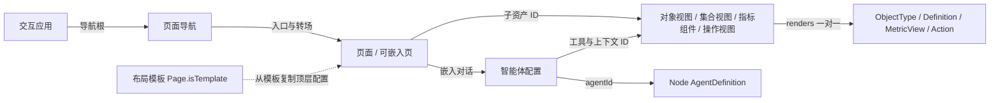

# Product assets

For changes to an existing hosted application, use the [hosted application maintenance guide](legacy-hosted-app-maintenance.md).

The current design is [产品层设计与整合说明](产品层设计与整合说明.md). Implementation progress and acceptance limits are recorded in [product-layer-v2-migration.md](product-layer-v2-migration.md).

Product assets have three categories:

| Category | Types | References |
| --- | --- | --- |
| Elements | ObjectView, CollectionView, MetricWidget, ActionView | Each renders exactly one ontology element |
| Compositions | Page, Navigation | Asset IDs; templates are `Page.isTemplate` |
| Intelligent applications | Application, AgentProfile | Page/Navigation roots or tool/context projections |

The directory and creation menus follow the consumption entry: Delivery bundles (交付单元), Composition assets (组合资产), Projection assets (投影资产). The default Application entry therefore belongs to the first category. Bundles list Application (应用) before AgentProfile (智能体配置); compositions list Page (页面) before Navigation (导航). Within projections, the order is ObjectView (对象视图), CollectionView (集合视图), MetricWidget (指标组件), then ActionView (动作视图). All labels use the Manager locale without appended raw English contract names. AgentProfile retains “智能体配置” to distinguish its tool/context/instruction configuration from the referenced Node agent definition.

Page forms are discoverable through directory filters: ordinary pages, embeddable pages, and page templates. Templates take precedence in this filter when both flags are set; the embeddable restriction still applies to such a template. These are forms of the same Page contract, not additional asset classes. Directory rows show the form and projection renderer. Default structural sorting follows the type order above, then ordinary pages, embeddable pages and templates, then names and asset IDs for stability. Explicit name and recent-update ordering remain available. All ordering is applied by the server before pagination. Filters and sorting survive opening an asset and returning to the directory.

Prefer asset instance names that describe the business subject and purpose. For example: `人员 · 档案摘要`, `在职人员 · 名册`, `在职人数 · 总览`, `人员 · 信息维护`, `师资工作台`, `师资工作台 · 布局模板`, `师资工作台 · 页面导航`, `师资管理`, and `师资分析助手`. Add an audience or renderer suffix only to distinguish otherwise identical projections. Keep technical IDs, revision numbers, owner and sharing state in metadata rather than names. Existing author-supplied names are not rewritten automatically.

The template-copy arrow describes an operation, not a persistent dependency. A copied page continues to reference its selected child assets. Page-to-Page references may stay within the composition layer, and embedding a profile crosses back to the bundle layer; the categories describe responsibilities rather than a strictly linear dependency hierarchy. Grant decisions remain in governance and are not inferred from any of these edges.

Page `layout` owns column proportions, grid mode and spacing. The platform runtime and manual editor consume the same layout; principal overlays only own personal resource selections and interaction preferences. Projection `display` accepts field sorting, row limits, colors and field formats. It cannot contain expressions or percentage scaling.

The full object-view editor now saves product-owned ObjectViews through `/product-assets/object-views/*`. Existing class definitions are read-only import sources. Standalone object entries keep their explicit published revision in the product repository; bundle publications continue to freeze the selected asset revisions independently.

Source manifests may declare `triggerIds` alongside `assetIds`. Each Trigger must have a declared CollectionView for its Definition. Publications freeze the Trigger contract, and the host admits only those declared subscriptions. Online subscription comparison state is checkpointed without credentials and can resume using the same ID and fresh caller credentials while its lease remains valid.

Authoring saves accept `{name, description, document, revision}`. Authorization is managed separately through use/edit Grants; new assets grant both verbs to their creator. Legacy `visibility` metadata remains readable for migration and historical snapshots, but is rejected by the current HTTP authoring contract and does not control directory access. The shared directory scope means assets created by others for which the current principal has a Grant.

Historical source releases using the earlier network policy remain migration inputs. Retrying their original commit or rolling back to them cannot reactivate that policy: migrate the source to `connectAppContext()`, declare its dependencies, and publish a new reviewed commit. Existing release files and history are retained. The standalone object entry resolves a complete archived asset, including fields and renderer, and overlays only the current edit decision; it never combines a published layout with the current draft definition.

Product configuration owns presentation, not business facts, calculations, rules or execution authorization. Personal preferences belong to principal overlays. Published bundles freeze recursive asset revisions and capability contracts; editing a child does not upgrade a release.

The authoring API, manual editor and Agent authoring commands share the product save boundary. SDK applications use `context.products`, `ProductAsset`, `context.metricViews`, `context.actions`, typed `context.navigate` and server-evaluated `context.subscribe`.

The product dependency graph is derived from caller-visible documents and preserves intermediate composition nodes. It does not independently own configuration or permission decisions. Product-index graph visualization does not mean ontology registration is complete; consult the migration status for the actual boundary.

The directory opens its reference graph in a full-screen dialog. Asset details offer the same expanded view. Zoom, fit-to-canvas and original-size controls support inspecting both the entire dependency structure and readable node details. The ontology graph links to this view from its header action “产品关系图”, keeping the ontology canvas available instead of inserting a second graph above it.

Default-projection checking is an advisory coverage check from the V2 design, not a requirement explicitly stated in the V1.1 whitepaper. It lists currently visible published ontology elements without a visible projection marked `isDefault`. Explicit asset references do not require complete default coverage. The check does not create assets or block publication. Results open in a dismissible dialog with type filtering, retry and an explanation of how to mark an existing projection as default.
