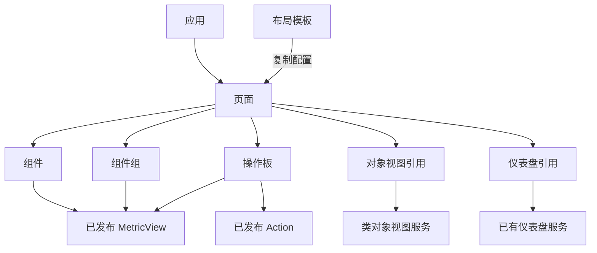

# 产品层设计与整合说明

更新日期：2026-11-13。

产品层负责定义业务能力如何被呈现、交互和组合。它统一管理页面、组件、对象视图、仪表盘入口及应用入口，让个人主页、人工编辑器和 App Builder 使用相同的产品资产。

产品资产保存展示配置和引用。指标口径、业务状态、操作规则、数据权限及运行结果由各自的能力、数据和治理服务拥有。调整展示不应要求复制业务逻辑，删除展示也不应删除业务能力或业务数据。

## 1. 设计目标

产品层主要解决四个问题：

1. **可发现**：已有页面、组件和视图能在本体管理器中统一查找、预览和使用。
2. **可复用**：同一个指标能力可以使用不同图表呈现，同一个对象类视图可以呈现不同对象，同一个组件可以被多个页面引用。
3. **可组合**：个人主页和业务页面通过布局与资产引用组合内容，应用通过入口和页面组织完整使用场景。
4. **可校验**：人工与 AI 使用相同的配置契约，保存前检查结构、能力引用、参数和产品组合，避免产生只能保存却不能运行的配置。

产品层采用少量固定类型，将局部差异留作实例配置。图表样式、字段顺序、标题、高度和打开方式通常不需要成为独立类型。

## 2. 为什么分为这八类资产

资产分类依据是**使用职责、组合方式和运行方式**。业务部门、作者是人还是 AI、个人或共享范围，都不会改变资产类型。

八类资产可以从使用粒度上理解为三组：

| 层次 | 类型 | 作用 |
| --- | --- | --- |
| 内容单元与局部组合 | 组件、组件组、操作板 | 提供可放置的展示或交互内容 |
| 专门视图与复用入口 | 对象视图、仪表盘 | 复用已经由专门服务管理的视图 |
| 页面组织与交付 | 页面、布局模板、应用 | 组织工作界面、复用默认配置、提供应用入口 |

这三组帮助理解粒度，不额外形成新的资产元类型。

### 2.1 组件：一个展示或交互单元

`widget` 表示一个可以独立配置和复用的单元，例如指标卡、柱状图、表格、说明文字或 Action 入口。

组件配置包含能力 ID、参数绑定、输出字段映射，以及标题、尺寸和图表样式。指标卡、表格和图表引用已发布的 MetricView；操作入口引用已发布的 Action。

**为什么单独分类**：组件是页面复用的基本单位。单个指标卡和一组卡片有不同的配置粒度，需要区分。

**为什么柱图、折线图、环形图不各建一类**：它们改变的是同一个指标结果的展示方式。`chartType` 足以表达差异，指标 ID 和业务口径无需改变。只有当展示模板需要跨大量组件独立复用和管理时，才值得进一步抽取。

### 2.2 组件组：多个纯展示单元

`widget-group` 将指标、图表、表格和说明组合为一个可复用区域，例如“师资规模”同时显示档案总数、在职人数和机构数。

组件组保存内部 widget 数组与布局。它不包含 Action，也不承载业务流程。

**为什么需要这类**：经常一起出现的内容可以整体复用，而无需每个页面重复排列。组件组具有稳定的整体含义，但仍比完整页面更小。

**为什么不能归为操作板**：纯展示组合回答“看什么”，操作板回答“能在这里做什么”。将两者混用，会使目录分类、编辑表单和用户预期不一致。

### 2.3 操作板：围绕业务操作组织交互

`operation-panel` 必须至少包含一个 Action 入口，也可以包含辅助指标、说明、参数输入和局部选择状态。

例如“学术交流来源核实”提供来源核实 Action 的参数表单；更复杂的操作板可以先展示相关信息，再将用户选择传给 Action。

**为什么单独分类**：操作板有明确的业务写入入口，需要检查 Action 引用、参数绑定、只读参数及执行后刷新。其主要职责与纯展示不同。

操作板只组织交互，不定义写入规则。前置条件、数据更新、业务校验和执行授权仍由 Action 与现有执行器负责。含多个独立 Action 不意味着形成一个原子事务或 Workflow。

### 2.4 对象视图：对象上下文中的专门界面

`object-view` 引用某个对象类已有的已发布视图，保存 `className`、`form` 和可选默认对象主键 `primaryKey`。

没有默认主键时，用户可以在运行时选择不同对象。切换对象不会修改类视图定义。保存默认主键只代表默认展示对象，不创建实例专属视图。

**为什么单独分类**：对象视图依赖对象上下文、类视图发布状态及对象导航，它的运行方式与一个普通指标组件不同。

**为什么只保存引用**：类视图的编辑、修订和发布已由对象视图服务管理。产品层再复制一份文档，会产生两个定义来源。

当前仅适配 `full` 类视图，尚不包含实例专属覆盖和对象集批量渲染。共享对象视图资产不携带个人默认对象主键。

### 2.5 仪表盘：已有看板的引用入口

`dashboard` 保存 `dashboardId`，引用已有个人仪表盘。仪表盘本身拥有卡片、指标引用、参数和看板布局。

**为什么保留此类**：完整仪表盘已经有自己的编辑和运行服务，适合作为整体入口复用。产品目录需要能发现并引用它。

**与组件组的区别**：组件组的内部展示配置直接保存在产品文档中；此处的仪表盘资产只引用原有看板，内容由仪表盘服务拥有。两者当前并不具有同一种编辑方式。

当前产品详情提供“打开仪表盘”入口。主页既有的关注仪表盘区块可预览其卡片。个人仪表盘不能直接进入域内共享模板；共享展示应使用引用 MetricView 的共享组件或组件组。

### 2.6 页面：完整工作界面的组合

`page` 保存页面布局、工作台配置和产品子资产引用。它可以是个人主页，也可以是独立业务总览页。

页面通过 `{assetId, column}` 引用内容，数组顺序表达展示顺序。页面负责组织主栏、侧栏、内置区块和交互偏好，不拥有子组件的业务能力。

**为什么单独分类**：页面是完整的工作表面，具有路由、布局与上下文；它不等同于局部组件组合，也不等同于应用身份。

### 2.7 布局模板：用于复制的页面预设

`layout-template` 保存可应用到个人主页的默认配置和组件引用。

应用模板时，将其配置复制到用户自己的主页，主页 ID 保持不变，子组件继续按引用使用。之后修改个人布局不会修改模板。

**为什么与页面分开**：页面用于运行和持续编辑，模板用于创建或替换默认配置；两者生命周期和操作入口不同。

当前模板同时包含内容选择与布局，属于“工作台预设”。尚未把纯几何布局和内容预设拆为两种资产，这符合当前复用粒度；未来可根据独立复用需求再拆分。

### 2.8 应用：身份、入口与页面组织

`application` 关联平台 `applicationId`、可选源码 `workspaceId`，以及显式产品子项。

应用身份、名称、发布引用及入口访问继续由平台应用目录管理。产品应用资产关联其产品组合，可以包含页面和可运行组件。

**为什么与页面分开**：一个应用可以拥有多个页面、导航和源码发布历史；页面只是一种运行内容。将应用等同于页面，会混淆入口权限、部署发布和页面配置。

已有托管应用和连接应用可关联到产品目录，但当前没有独立的 3D 组件运行协议或任意可执行插件注册机制。

### 2.9 类型选择规则

| 需求 | 选择 |
| --- | --- |
| 展示一个指标、一个图表或一张表 | 组件 |
| 多个展示内容需要整体复用 | 组件组 |
| 围绕一个或多个 Action 提供处理入口 | 操作板 |
| 针对不同对象复用类上发布的界面 | 对象视图 |
| 复用已有完整仪表盘 | 仪表盘引用 |
| 组织完整工作界面 | 页面 |
| 给用户提供可复制的主页默认方案 | 布局模板 |
| 提供应用入口、身份及页面组织 | 应用 |

这些产品类型是产品服务内固定的文档契约，不应被创建为事实层业务对象类。业务差异优先成为实例、能力引用或参数。

## 3. 统一资产模型

所有资产共享以下信息：

| 字段 | 职责 |
| --- | --- |
| `id` | 稳定产品资产标识 |
| `name`、`description` | 面向使用者的名称与说明 |
| `ownerId` | 资产所有者，由服务端身份确定 |
| `visibility` | `private` 或 `domain` |
| `document` | 以 `kind` 区分的类型专有配置 |
| `revision` | 编辑并发令牌 |
| `createdAt`、`updatedAt` | 创建与修改时间 |
| `editable` | 返回时按当前主体计算的可编辑状态 |

客户端不能指定所有者或数据域。资产类型创建后不能通过普通编辑改变；存量职责纠正由明确迁移完成。

产品编辑修订不是能力版本。修改共享组件会影响所有引用它的页面；需要独立变化时，应先复制组件，再调整个人页面引用。复制页面或模板只复制顶层配置，子组件仍按引用使用，并非深复制整棵资产树。

## 4. 组合结构与运行机制



页面和模板可包含组件、组件组、操作板、对象视图与仪表盘；应用还可以包含页面。页面不嵌套另一个页面，也不包含应用或模板，因此当前组合规则不需要任意层级的页面递归。

组件组和操作板内部保存 widget 配置，共用局部交互变量。它们当前不通过资产 ID 引用内部每个 widget。局部输入、行选择、参数传递和执行后刷新属于展示交互，计算口径和业务操作规则属于能力。

指标组件直接消费 MetricView 返回的行数组，因此 `resultPath` 必须为空。组件选择哪些输出字段用于标题、数值或坐标，不在界面中计算新口径。

图表类型与指标引用独立：改变 `chartType` 不改变 `resourceId`。当前独立产品图表支持 ECharts 柱图、折线图与环形图；地图、关系图等专门展示继续通过已有对象视图使用。

## 5. 个人主页与独立产品页面

`/home` 是个人主页，旧 `/workspace` 跳转到这里。`/products/<assetId>` 打开独立产品页面或组合，`/applications` 是应用广场。

个人主页首次读取时，将原个人工作台和原主页配置合并为一个页面资产，并通过 `product_home` 保存用户到页面的指向。原行保留用于回退，当前读写使用产品资产。

主页文档包括两部分：

- `workspace`：常用应用、关注仪表盘、收藏对象、会话、任务动态、最近访问等内置区块及交互偏好。
- `children`：从产品目录选择的独立产品资产引用。

“配置主页 → 资源内容”支持选择产品资产、添加到主栏或侧栏、调整顺序和移除。保存时页面的工作台配置和子资产引用一起更新，不修改共享子组件。

内置六个区块仍是结构化页面配置，没有全部成为独立资产。新增产品组件位于各栏内置区块之前，当前不能在两组内容之间任意穿插。

最近访问记录、会话内容、定时任务状态和查询结果保留在原服务中。删除页面允许丢失布局和个人展示偏好，但不应丢失业务状态、口径、操作规则或授权。

## 6. 人工编辑与 AI 构建

人工编辑器、App Builder CLI 和 SDK 使用同一种资产文档与保存规则。

```text
发现类型和 Schema → 读取资产 → 修改展示或引用
  → 携带当前修订保存 → 服务端准入 → 回读 → 运行
```

人工编辑器支持能力选择、组件配置、图表样式、产品组合，以及组件组或操作板内部 widget 的选择、添加和移除。完整 JSON 用于表单尚未覆盖的配置。

App Builder 命令包括：

```text
product types
product list
product home
product get <id>
product save <id> <json|@file>
product copy <id> <name>
product use-home <id> <current-home-revision>
product delete <id> <revision>
```

`types` 返回类型和 JSON Schema。创建使用新 ID 与修订 0，修改使用读取到的修订。旧修订返回 `PRODUCT_CONFLICT`，需要重新读取并合并变更。

SDK 的 `context.products` 提供 `list/get/home/save/copy/useHome/delete`。构建测试预览中的 SDK 禁止产品服务调用，产品编辑使用 authoring CLI；业务执行继续遵守原有构建测试上下文。

声明式产品资产可以由人工和 AI 交替编辑。任意自定义 HTML/JavaScript 不会自动转化为可由配置表单完整编辑的页面。

## 7. 保存准入与合法配置

公共保存服务先检查所有者与编辑修订，再进行结构、能力及递归产品子项校验。产品创建、修改、复制、模板应用、主页更新和应用登记都通过这条保存边界。首次主页迁移也检查旧能力引用。

主要约束如下：

| 约束 | 目的 |
| --- | --- |
| 严格类型结构，拒绝额外 SQL/DSL 字段 | 防止配置成为计算逻辑容器 |
| 操作板必须包含 Action；组件组只能展示 | 保持类型职责与运行方式一致 |
| MetricView 和 Action 已发布且可访问 | 避免引用不可运行的能力 |
| 输出字段与参数名称匹配 | 避免保存错误映射 |
| 指标参数有绑定或声明默认值 | 避免运行时缺参 |
| Action 只读参数存在且已绑定 | 避免形成不可填写的无效表单 |
| 指标结果路径为空，不允许本地数据替代 | 与行数组返回契约一致 |
| 局部变量具有输入、表格选择或按钮来源 | 避免悬空交互绑定 |
| 共享资产不引用私有产品子项 | 避免共享组合失去可用依赖 |
| 被引用资产和当前主页不能直接删除 | 避免破坏现有组合 |

旧个人工作台 PUT 要求 `If-Match`，缺失返回 428。普通产品更新通过请求体 `revision` 保护并发修改。

结构校验不能证明自然语言、任意 literal 值或自定义源码的全部语义正确。业务口径正确性仍需要能力评审和实际数据验证。

## 8. 应用发布与回滚

自定义源码继续由原工作区、Git 提交和托管应用发布机制管理。应用可提交 `ontomato.products.json`：

```json
{
  "schemaVersion": 1,
  "assetIds": ["<实际产品资产 ID>"]
}
```

发布从指定的已有提交读取清单，切换前检查产品引用及其子项，然后发布文件、更新平台应用目录，并使用同一个平台应用 ID 登记产品应用资产。回滚读取目标提交中的清单并恢复引用。

清单是显式产品依赖声明，不是任意源码的完整静态分析。清单缺失只表示未声明产品引用。源码应用可以使用 SDK 读取产品资产，或导航到 `/products/<pageAssetId>` 复用已有页面。

发布涉及文件、Node 产品表和 Java 应用目录，当前没有跨服务事务。发生部分失败时，需要重试并核对最终目录和产品登记，不能仅凭导出记录判定发布成功。

## 9. 存储、权限与依赖查询

产品服务使用两张表：

- `product_assets`：以 `(domain_id, id)` 为主键，保存资产文档、所有者、可见范围和编辑修订。
- `product_home`：以 `(domain_id, user_id)` 指向个人主页。

修改在域级事务锁下检查和保存，避免引用创建与删除竞争。产品文档属于产品服务，能力、对象视图和平台应用目录仍由各自服务拥有。

当前协作权限为 `private/domain` 加所有者编辑规则。共享资产不会授予业务数据或 Action 权限，运行请求始终携带当前访问者身份。

个人主页不能直接共享。共享模板不包含个人对象、会话或 Agent 书签；个人仪表盘不能直接成为共享模板依赖。需要共享的指标展示使用共享组件或组件组。

产品依赖从配置派生，递归查询只遍历当前主体可见的资产。例如：

```text
应用 → 页面 → 组件组 → MetricView
```

详情可查看展开后的产品依赖与间接使用者。私有父页面不会因另一用户查看共享组件而被泄露。已有对象视图内部能力和旧仪表盘内部卡片尚未纳入产品递归查询。

## 10. 与四层架构的边界

产品层的基本纪律是：只组织呈现与交互，能力定义和业务事实保留在下层。当前声明式组件通过能力引用执行读写，但仍有以下明确边界：

| 项目 | 当前状态 |
| --- | --- |
| 产品类型与校验 | 已有独立文档契约、保存准入和渲染分派 |
| 统一逻辑图与内核元类 | 产品表尚未接入内核 `ViewType` 与封闭跨层边集合 |
| 对象视图读取 | 兼容服务仍直接读取对象属性和关系，受原服务控制 |
| 能力版本 | 保存能力 ID，尚无固定版本选择；运行时变化由现有服务处理 |
| 统一治理来源 | 产品协作规则尚未归入统一 Grant 图 |
| 源码依赖 | 依靠显式清单，尚无任意源码完整分析 |

编辑修订、源码历史和部署发布是工程机制，不等于能力层的业务审核与版本制度。产品可丢弃不代表无须结构校验，也不代表必须允许删除正在被引用的资产。

## 11. 管理界面与使用体验

本体管理器以“产品层 → 产品资产”作为入口。页面由共享页头、类型导航、分组目录和详情组成。

- 类型导航展示数量，每种类型使用不同图标。
- 全部目录按类型分组，选择类型后集中浏览，搜索在当前范围内生效。
- 详情优先显示名称、说明和实际可用内容；应用和仪表盘显示打开入口，页面与模板显示组合，组件类显示运行预览。
- 引用关系和配置详情默认折叠；复制、保存模板和删除位于更多菜单。
- 页头固定，目录与详情分别滚动；窄区域切为上下布局。
- 间距使用现有 UI token，折叠行遵循管理器平直浅底反馈；嵌入图表收紧内部绘图区边距，保留标签所需空间。

主页采用独立配置弹窗，额外组件选择放在“资源内容”页签。嵌入式产品组件按内容撑高，避免继承整页高度后覆盖后续区块。

## 12. 验证范围

已有验证覆盖：

- 纯展示操作板迁为组件组，保留 ID 和页面引用。
- 人工与 AI 读取、修改同一资产，图表样式切换不改变指标引用。
- 同一类对象视图切换对象，主页添加产品组件并保存。
- 组件组内部选择和编辑，以及迁移后主页指标正常呈现。
- 非法操作板、结果路径、替代数据绑定、错误输出字段、共享私有依赖、缺失修订、过期修订和被引用删除被拒绝。
- 产品保存服务的所有者边界、统一准入和可见资产依赖遍历。
- 示例应用发布后登记页面引用，以及不同窗口尺寸下的滚动与交互。

真实受限账号的完整业务复用和 Action 写入尚未完成端到端验收。表单能打开不等于业务写入已验证。产品运行正常也不代表统一治理、能力版本和内核依赖图已经完成。

## 13. 主要代码入口

| 内容 | 文件或目录 |
| --- | --- |
| 产品类型、资产和直接引用 | `packages/contracts/src/product-assets.ts` |
| 产品依赖遍历 | `packages/contracts/src/product-dependencies.ts` |
| 产品存储与统一保存边界 | `packages/workbench-server/src/services/product-assets/store.ts` |
| 能力与引用校验 | `packages/workbench-server/src/services/product-assets/validation.ts` |
| 表结构与展示组合迁移 | `packages/workbench-server/src/infrastructure/postgres-migrations/20261112-product-assets/` |
| 产品 HTTP API | `packages/workbench-server/src/api/routes/product-assets.ts` |
| 资产目录和运行适配 | `packages/ontology-manager/src/products/` |
| 原类对象视图 | `packages/ontology-manager/src/object-views/` |
| 主页与独立页面 | `packages/platform-web/src/pages/PersonalWorkspaceRoute.vue`、`ProductRoute.vue` |
| 应用发布与登记 | `packages/workbench-server/src/services/workspaces/hosted-apps.ts` |
| SDK 产品客户端 | `packages/ontology-manager/src/clients/products.ts`、`packages/apps-sdk/src/context.ts` |
| AI 构建命令 | `agent-skills/ontomato-app-builder/` |
