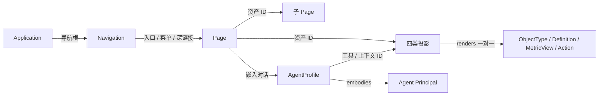

# 产品层设计与整合说明

产品层设计以用户提供的《产品层设计 v2（修订稿）》为唯一设计基准。三级资产为**投影资产、组合资产、交付单元**；正文表格实际定义四类投影、两类组合、两类交付，共八类，标题“三级六类”不作为删减类型的依据。修订稿未定义的产品能力不新增、不对外提供；修订稿明确保留的工程实现与 SDK 章节继续有效。页面模板保留为 `Page.isTemplate`，不恢复独立类型。本文仅为工程索引，不能扩充或覆盖修订稿；实际实施与验收范围以[迁移记录](product-layer-v2-migration.md)为准。

## 资产模型与引用

产品层是本体的投影面，决定事实与能力以什么面孔呈现给人与 Agent，不拥有口径、业务规则、事实或执行授权。删除产品资产只允许丢失呈现与偏好；在用不可删除属于依赖保护。

| 层次 | 类型 | 引用与内容 |
| --- | --- | --- |
| 投影资产 | ObjectView | 一条 renders 指向已发布 ObjectType；full / summary / card / text / 3d |
| 投影资产 | CollectionView | 一条 renders 指向已发布 Definition；table / list / chart / map / 3d-scene |
| 投影资产 | MetricWidget | 一条 renders 指向已发布 MetricView；number / trend / gauge / chart |
| 投影资产 | ActionView | 一条 renders 指向已发布 Action；form / button / dialog / inline |
| 组合资产 | Page | 有序资产 ID 引用、布局、带本体类型的参数；embeddable / isTemplate 标记 |
| 组合资产 | Navigation | Page 的入口节点、菜单与深链接 |
| 交付单元 | Application | 面向人的 Navigation 与 Page 根、依赖和发布记录；平台目录身份使用同一应用 ID |
| 交付单元 | AgentProfile | 工具投影、对象上下文和指令；embodies 指向 Agent Principal |

同一本体元素允许多个投影，renderer 是实例属性。已发布元素缺少默认投影产生警告。关系、事件、时序是 ObjectView 区块；条件关系集合由 Definition 通过 CollectionView 呈现。Trigger 没有投影。WorkflowView / SkillEntry 保留为未来扩展，当前不新增资产类型。

三段关系分别拥有：投影到本体的 renders 在本体图；应用到组合和投影的引用在产品仓派生索引；主体到 Application / AgentProfile 的 use/edit 在治理 Grant。依赖界面可合并展示这些关系，但不改变其归属。Page 与 Navigation 不作为本体图节点注册。

## 组合与用户状态

Page 不内联投影配置，只引用资产 ID；允许子 Page，禁止循环。`embeddable` 的无 Action 限制递归覆盖子页面和 ObjectView 中的 Action。模板复制创建新的 Page，继续引用共享子资产。

页面参数声明本体类型，例如 `selected: Person`。对象状态只传递 `{className, primaryKey}` 身份引用；显示属性由受治理接口读取。绑定检查能力签名类型，子 Page 参数必须有兼容来源。页面转场遵守发布 Navigation；SDK 可以打开具体对象的指定 ObjectView。

资源选择、收藏和交互偏好保存在 Principal overlay，不进入共享 Page 修订与发布依赖。页面共享采用 private/shared 意图；实际访问与编辑只由 Grant 决定。Application 或 Profile 的 use 不授予数据或 Action 权限。

平台任务、会话、收藏、最近访问、应用是开放注册的平台对象；它们使用 ObjectView / CollectionView。问数面板嵌入 AgentProfile。新增平台交互不扩充封闭来源枚举。

## 运行与发布

读链路：投影 → 已发布元素 → 受治理执行或无逻辑直读 → 字段映射与格式化 → 渲染。显示格式只允许单位、精度、本地化、排序与颜色；同比、环比、占比和汇率换算属于 MetricView。产品配置拒绝 SQL、DSL、业务谓词和计算表达式。CollectionView 参数不超出 Definition 签名。

写链路：ActionView → Action 签名参数校验 → 治理判定 → 执行 → 按 Action affects 失效并回读。页面不猜测数据依赖；多个操作不自动成为事务或 Workflow。

订阅在服务端调度求值，SDK 只接收已点火事件并执行显示 Effect。AgentProfile 用相同投影装配工具面和上下文，3D ObjectView 可同时作为对象面孔与声明字段的模型上下文。Profile 不拥有权限，换 Profile 不换 Principal 的授权。

编辑态跟随最新。发布 Application / AgentProfile 捕获递归子资产 revision 和能力契约哈希；子资产升级由所有者显式发布。运行契约漂移必须明确标记和降级，不能静默空白。回滚选择发布记录，恢复其冻结子资产。发布快照不冻结权限判断。

源码应用注册为产品层 Function，依赖清单声明受治理接口；数据与能力只能经 SDK 到达。发布检查构建产物，review 由构建派生，网络层封闭直连。源码访问隔离与业务语义归属必须分别成立。

## 工程边界

人工、Agent CLI 和 SDK 共用资产 ID、修订与保存服务。保存检查结构、发布状态、签名、组合、权限和并发冲突；被引用资产、主页和发布快照保留资产不可直接删除。

| 职责 | 入口 |
| --- | --- |
| 资产契约、引用与分层图 | `packages/contracts/src/product-assets.ts`、`product-projections.ts`、`product-graph.ts` |
| 保存、迁移、依赖、发布 | `packages/workbench-server/src/services/product-assets/` |
| 人工目录与投影运行 | `packages/ontology-manager/src/products/` |
| 页面与宿主导航 | `packages/platform-web/src/pages/`、`app-host.ts` |
| SDK | `packages/apps-sdk/src/context.ts`、`ProductAsset.vue` |
| 源码发布与准入 | `packages/workbench-server/src/services/workspaces/hosted-apps.ts`、`product-admission.ts` |
| 治理适配 | Java 产品 Grant 服务、企业主体与角色实现 |

兼容存量的旧类型、旧字段与旧发布，不作为新增设计契约。迁移必须保留身份、事实与授权语义；具体剩余兼容路径、测试和真实验收记录统一维护在[迁移记录](product-layer-v2-migration.md)，不以类型声明或单元测试替代完整运行验收。
